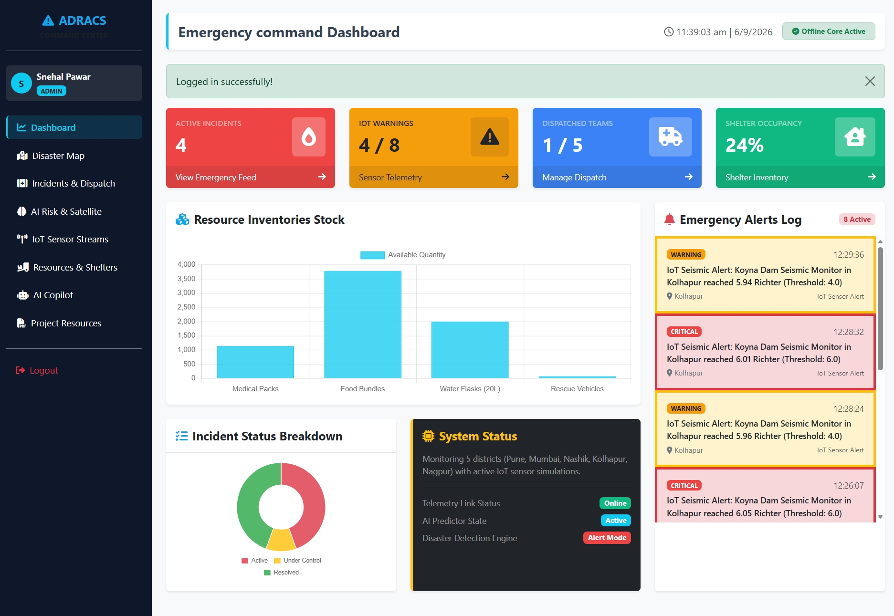
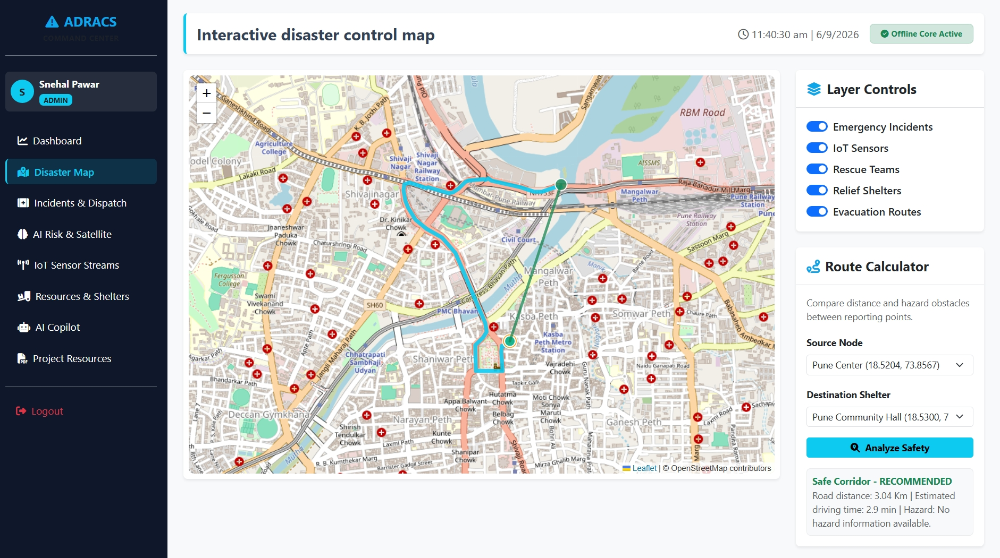
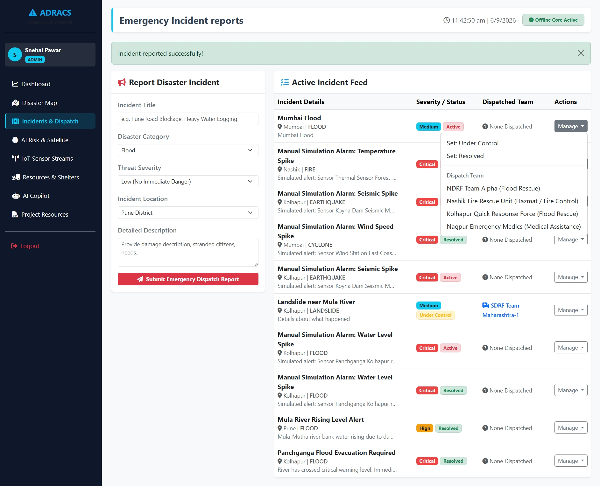
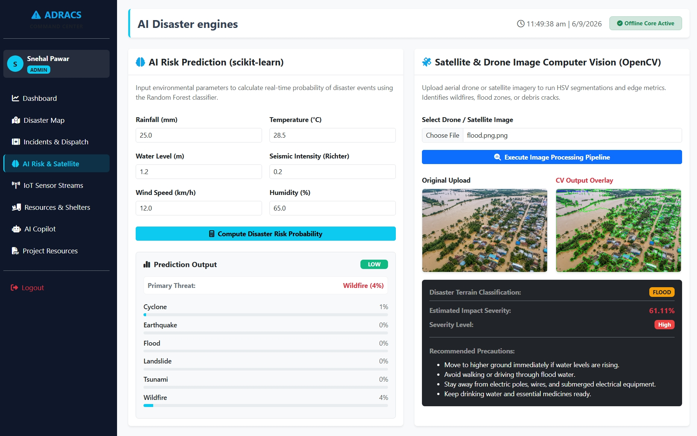
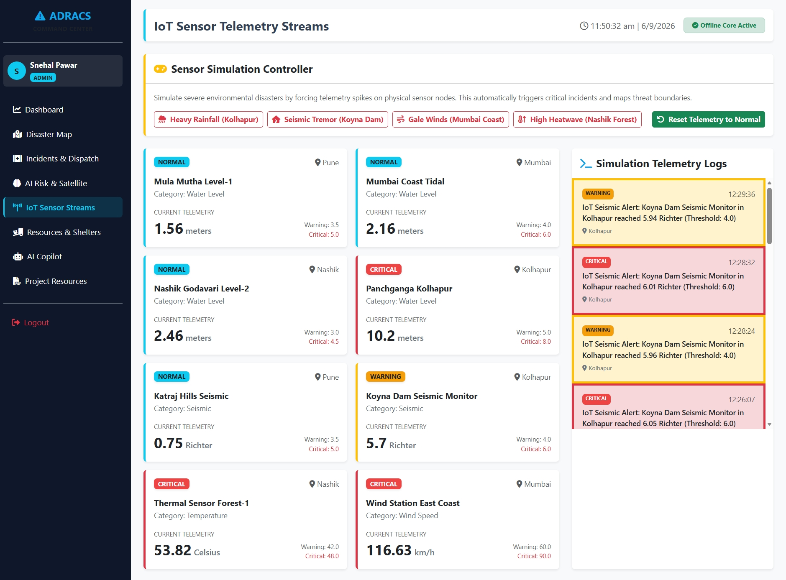
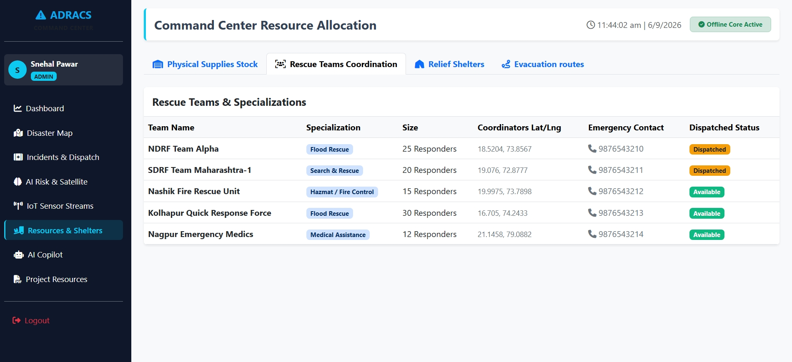
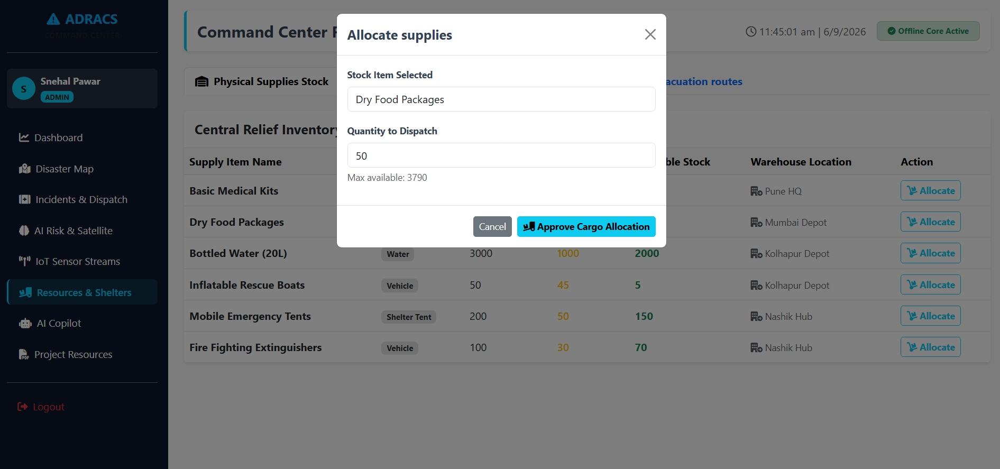
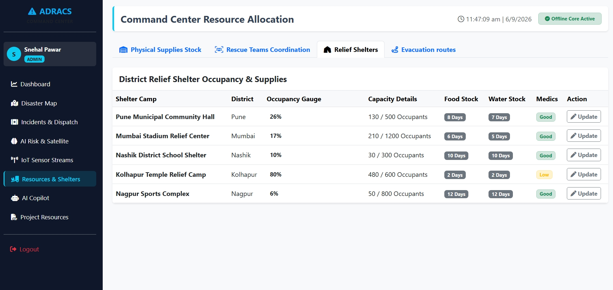
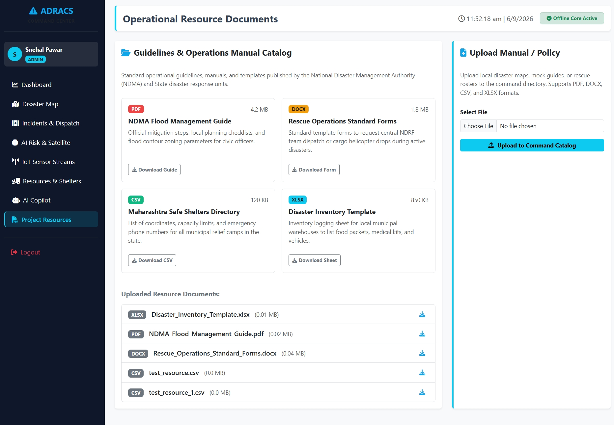
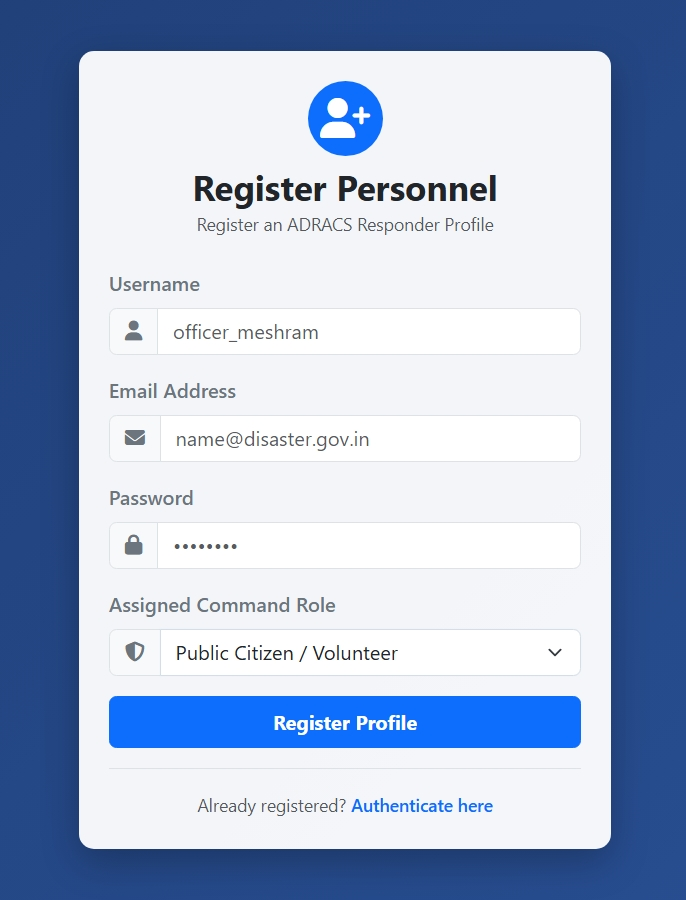

# 🚨 AI-Powered Autonomous Disaster Response & Coordination System (ADRACS)

> **A production-oriented prototype Emergency Command and Disaster Response platform built with Python Flask, SQLite, Leaflet.js, Chart.js, scikit-learn, and OpenCV.**

ADRACS is an intelligent disaster-management and emergency coordination platform designed to assist responders during critical situations.

The system combines **IoT telemetry simulation, AI-based disaster risk prediction, computer vision, incident evidence review, explainable prioritization, constrained team/resource planning, shelter monitoring, and graph-based route replanning** in a centralized command platform.

---

## 🚀 Key Modules Included

### 1. 🔐 Secure Role-Based Authentication

ADRACS provides role-based authentication for different categories of users:

* **Admin** — full command and management capabilities
* **Responder** — field operations, incident updates, and telemetry monitoring
* **Public** — citizen hazard reporting and emergency information

Role-based authorization protects sensitive operations such as resource allocation and rescue-team dispatch.

---

### 2. 📊 Live Emergency Dashboard

The Emergency Dashboard provides a centralized operational overview.

It displays information such as:

* Active incidents
* Disaster statistics
* Resource stock
* Shelter vacancies
* Rescue-team availability
* Risk information
* Emergency warnings
* Dynamic operational information

The dashboard is connected to application data rather than relying on hard-coded demonstration values.

---

### 3. 🗺️ Interactive Disaster Map

ADRACS provides a full-width interactive map using **Leaflet.js**.

The map can visualize:

* 🚨 Active incidents
* 📡 IoT sensor nodes
* 🏠 Emergency shelters
* 🚑 Rescue teams
* 🛣️ Evacuation routes

Map filters and route analysis help responders understand the geographic emergency situation.

---

### 4. 🚨 Incident & Dispatch Manager

The Incident Manager allows authorized users to manage emergency incidents.

Capabilities include:

* Report incidents
* Create incidents
* View incident details
* Update incident status
* Track incident locations
* Assign rescue teams
* Monitor severity

Supported incident states:

```text
Active → Under Control → Resolved
```

### 5. 🧭 Evidence-Aware Operations Center

The Operations Center at `/command-center` adds:

* Source-tagged incident evidence with freshness, duplicate suggestions, and conflicting-claim review.
* A deterministic, explainable priority score; the evidence score is a heuristic, not a calibrated probability.
* Backend-generated team assignments with capability, team-capacity, and road-graph constraints.
* Inventory need/shortage estimates and an unserved-incident list.
* Proposed plans, comparison history, and administrator approval before consequential actions.
* Persisted road-condition events that rerun route and team allocation recommendations.
* Shelter occupancy and accessibility records, with unknown information identified explicitly.
* A repeatable, synthetic Pune demonstration scenario.

The demonstration road network is a stored graph, not a live road feed. The map shows its recorded edges; graph routes include an explicit warning that routing output does not certify road safety. Where no graph route exists, the interface labels the route unknown rather than presenting a straight-line estimate as a safe route.

---

### 5. 🤖 AI Disaster Risk Predictor

ADRACS includes a **scikit-learn Random Forest classifier** for disaster-risk prediction.

The model can use environmental parameters such as:

* Rainfall
* Temperature
* Water level
* Seismic activity
* Wind speed
* Humidity

The system estimates disaster probabilities and supports classification of disaster types such as:

* Normal
* Flood
* Earthquake
* Fire
* Cyclone
* Landslide
* Tsunami

---

### 6. 📡 IoT Sensor Stream Simulator

ADRACS includes an integrated IoT telemetry simulator for development and demonstration.

It simulates disaster-related measurements such as:

* Water levels
* Seismic activity
* Thermal conditions
* Wind/gale speeds

The simulator can generate telemetry across locations including:

* Pune
* Mumbai
* Nashik
* Kolhapur
* Nagpur

When configured thresholds are exceeded, the system can generate emergency alarms or trigger incident-related processing.

> **Note:** The current IoT implementation is a simulation environment and does not represent live physical sensor hardware.

---

### 7. 🛰️ Drone & Satellite OpenCV Analyzer

ADRACS includes an image-analysis pipeline using **OpenCV**.

The analyzer can process uploaded disaster imagery using computer-vision techniques such as:

* HSV color segmentation
* Canny edge detection
* Image-density analysis
* Highlighted overlay generation

It is designed to assist with identifying visual patterns associated with:

* 🔥 Wildfire areas
* 🌊 Flood boundaries
* 🏚️ Structural damage

The analyzer produces visual overlays that can help responders interpret disaster imagery.

---

### 8. 📦 Logistics, Teams & Shelters Tracker

ADRACS provides centralized tracking for emergency operations.

### Resources

The system can track:

* Medical kits
* Food packages
* Bottled water
* Rescue boats
* Total quantity
* Allocated quantity
* Available quantity
* Storage/location information

The system prevents allocation beyond the available inventory.

### Rescue Teams

Teams can have statuses such as:

```text
Available
Dispatched
Off-Duty
```

### Shelters

Shelter records include:

* Capacity
* Current occupancy
* Remaining capacity
* Location
* Availability

---

---

### 10. 📁 Project Resources Directory

The Resources Directory provides a centralized location for project and administrative materials.

It can support:

* Agency manuals
* CSV datasets
* Templates
* Emergency contact information
* Administrative policies
* Project documentation

---

# 🎬 Feature Demonstration Flow

ADRACS is designed to demonstrate an **end-to-end disaster-response workflow**, rather than isolated features.

```text
                 DISASTER / SENSOR EVENT
                          │
                          ▼
                 IoT Telemetry Stream
                          │
                          ▼
                  Threshold Detection
                          │
                          ▼
               Incident Alert / Report
                          │
                          ▼
                  AI Risk Assessment
                          │
                          ▼
                 Incident Prioritization
                          │
                          ▼
                Rescue Team Selection
                          │
                          ▼
                    Team Dispatch
                          │
                          ▼
                 Resource Allocation
                          │
                          ▼
               Shelter Availability Check
                          │
                          ▼
              Evacuation Route Analysis
                          │
                          ▼
             Evidence & Priority Review
                          │
                          ▼
                   Field Response
                          │
                          ▼
                  Incident Status Update
                          │
                          ▼
                       RESOLVED
```

---

## 🧪 Example: Flood Response Demonstration

A typical ADRACS demonstration can use a flood scenario.

### Step 1 — Login

Log in using an appropriate role such as **Admin** or **Responder**.

---

### Step 2 — Dashboard

Review the current emergency situation:

* Active incidents
* Available teams
* Resource inventory
* Shelter availability
* Risk information

---

### Step 3 — IoT Monitoring

Open the IoT Sensor module and monitor simulated water-level telemetry.

```text
Water Level
     ↓
Threshold Check
     ↓
Abnormal Condition
     ↓
Flood Warning / Incident Processing
```

---

### Step 4 — Incident Management

Create or inspect the flood incident.

Example:

```text
Incident:
Panchganga Flood Evacuation Required

Disaster Type:
Flood

Location:
Kolhapur

Severity:
Critical

Status:
Active
```

---

### Step 5 — AI Risk Prediction

Provide environmental values to the AI Risk Predictor.

```text
Rainfall
Temperature
Water Level
Seismic Activity
Wind Speed
Humidity
        ↓
Random Forest Model
        ↓
Risk / Disaster Prediction
```

---

### Step 6 — Rescue Team Dispatch

Check available response teams and assign an appropriate team.

```text
Active Incident
       ↓
Available Team
       ↓
Dispatch
       ↓
Team Status = Dispatched
```

---

### Step 7 — Resource Allocation

Check emergency inventory and allocate required resources.

Example resources:

```text
Medical Kits
Food Packages
Bottled Water
Rescue Boats
```

The system verifies available inventory before allocation.

---

### Step 8 — Shelter Check

Review available emergency shelters.

```text
Affected Area
      ↓
Nearby Shelters
      ↓
Check Capacity
      ↓
Select Suitable Shelter
```

---

### Step 9 — Evacuation Route

Use the Disaster Map and route analyzer to evaluate the evacuation corridor.

The system can provide:

* Distance
* Estimated travel time
* Route
* Route condition

Possible route conditions:

```text
✅ Safe
⚠️ Congested
🚫 Blocked
```

---

### Step 10 — Evidence Review and Replanning

Open Operations Center, inspect the simulated evidence and priority rationale, generate a proposed plan, then mark the simulated Riverside bridge inaccessible to compare the revised routes and assignments. Approval records a human decision only; it does not dispatch a team.

---

### Step 11 — Incident Resolution

As the emergency response progresses:

```text
Active
  ↓
Under Control
  ↓
Resolved
```

---

### Step 12 — Verify Dashboard

Return to the Dashboard and verify that operational information reflects the latest system state.

This demonstrates the connection between:

```text
Incident
Team
Resources
Shelter
Route
       ↓
   Application
       ↓
   Dashboard
```

---

# 🎯 Recommended 5-Minute Demonstration

|   Time | Module            | Demonstration                               |
| -----: | ----------------- | ------------------------------------------- |
| 30 sec | Authentication    | Login as Admin/Responder                    |
| 30 sec | Dashboard         | View emergency overview                     |
| 40 sec | Disaster Map      | View incidents, sensors, teams and shelters |
| 40 sec | IoT Sensors       | Demonstrate telemetry                       |
| 40 sec | Incident Manager  | Create/view an emergency                    |
| 40 sec | AI Risk Predictor | Run disaster-risk prediction                |
| 30 sec | Team Management   | Dispatch a rescue team                      |
| 30 sec | Resources         | Allocate emergency resources                |
| 30 sec | Shelters          | Check shelter capacity                      |
| 30 sec | Route Analyzer    | Evaluate evacuation route                   |
| 40 sec | Operations Center | Review evidence and priorities               |
| 40 sec | Replanning         | Close a simulated road and compare plans     |
| 20 sec | Dashboard         | Verify final operational state              |

### ⭐ One-Line Demo Story

> **A report is reviewed → incidents are prioritized → a feasible response plan is proposed → route conditions change → affected recommendations are recalculated → an authorized administrator reviews the new plan.**

---

# 🏗️ System Architecture

```text
                         ┌──────────────────────┐
                         │       USERS          │
                         │ Admin / Responder    │
                         │ Public               │
                         └──────────┬───────────┘
                                    │
                                    ▼
                         ┌──────────────────────┐
                         │    WEB INTERFACE     │
                         │ HTML / CSS / JS      │
                         │ Leaflet / Chart.js   │
                         └──────────┬───────────┘
                                    │
                                    ▼
                         ┌──────────────────────┐
                         │    FLASK BACKEND     │
                         │ Routes / APIs        │
                         │ Authentication       │
                         └──────────┬───────────┘
                                    │
             ┌──────────────────────┼──────────────────────┐
             │                      │                      │
             ▼                      ▼                      ▼
      ┌──────────────┐       ┌──────────────┐       ┌──────────────┐
      │    SQLite    │       │  AI Engine   │       │   Routing    │
      │  SQLAlchemy  │       │ RF / OpenCV  │       │     OSRM     │
      └──────┬───────┘       └──────────────┘       └──────────────┘
             │
             ▼
 ┌────────────────────────────────────────────────────────────┐
 │ Incidents │ Teams │ Resources │ Shelters │ Sensors │ Routes│
 │ Users     │ Historical Disaster Records                    │
 └────────────────────────────────────────────────────────────┘

             ┌──────────────────────┐
             │    IoT Simulator     │
             └──────────┬───────────┘
                        │
                        ▼
                 Sensor Telemetry
                        │
                        ▼
                  Risk / Alerts
```

---

# 🔄 Disaster Response Workflow

```text
Disaster Detected
       │
       ▼
Sensor / Citizen Report
       │
       ▼
Incident Created
       │
       ▼
Risk Assessment
       │
       ▼
Incident Prioritization
       │
       ▼
Rescue Team Selection
       │
       ▼
Team Dispatch
       │
       ▼
Resource Allocation
       │
       ▼
Shelter Assessment
       │
       ▼
Evacuation Route Analysis
       │
       ▼
Emergency Response
       │
       ▼
Incident Under Control
       │
       ▼
Incident Resolved
```

---

# 🛠️ Technology Stack

| Category             | Technology                          |
| -------------------- | ----------------------------------- |
| Programming Language | Python 3.11                         |
| Backend              | Flask                               |
| ORM                  | Flask-SQLAlchemy / SQLAlchemy       |
| Database             | SQLite                              |
| Frontend             | HTML5, CSS3, JavaScript             |
| Templates            | Jinja2                              |
| Maps                 | Leaflet.js                          |
| Charts               | Chart.js                            |
| Machine Learning     | scikit-learn                        |
| ML Model             | Random Forest                       |
| Computer Vision      | OpenCV                              |
| Image Processing     | HSV / Canny                         |
| Routing              | OSRM                                |
| Map Data             | OpenStreetMap                       |
| Operations planning | SciPy linear assignment + stored-road-graph Dijkstra |
| Testing              | pytest                              |
| Development          | Windows 11 / PowerShell             |

---

# 📁 Project Structure

```text
Autonomous Disaster Response & Coordination System/
│
├── app.py
├── seed.py
├── requirements.txt
├── README.md
│
├── models/
│   ├── __init__.py
│   ├── incident.py
│   ├── team.py
│   ├── shelter.py
│   ├── resource.py
│   ├── sensor.py
│   ├── route.py
│   └── user.py
│
├── routes/
│   ├── dashboard_routes.py
│   ├── incident_routes.py
│   ├── team_routes.py
│   ├── resource_routes.py
│   ├── shelter_routes.py
│   ├── iot_routes.py
│   ├── ai_routes.py
│   └── map_routes.py
│
├── utils/
│   ├── database.py
│   ├── ai_engine.py
│   └── routing.py
│
├── templates/
│   ├── dashboard.html
│   ├── incidents.html
│   ├── map.html
│   ├── teams.html
│   ├── resources.html
│   ├── shelters.html
│   ├── ai.html
│   └── ...
│
├── static/
│   ├── css/
│   ├── js/
│   └── images/
│
├── tests/
│   └── ...
│
└── instance/
    └── database.db
```

> The exact file names may vary slightly depending on the current project version.

---

# ⚙️ Installation & Initialization

## Windows 11

### 1. Prerequisites

Ensure the following are installed:

* Python 3.11
* pip
* Git
* A modern web browser

---

## 2. Clone / Open the Project

```powershell
git clone <your-repository-url>

cd "Autonomous Disaster Response & Coordination System"
```

---

## 3. Create Virtual Environment

A virtual environment is recommended to isolate project dependencies.

```powershell
python -m venv venv
```

Activate it:

```powershell
.\venv\Scripts\activate
```

---

## 4. Install Dependencies

```powershell
pip install -r requirements.txt
```

---

## 5. Initialize & Seed Database

Run:

```powershell
python seed.py
```

The seed process initializes the development database with demonstration data such as:

* Users
* IoT sensor nodes
* Rescue teams
* Shelters
* Resources
* Evacuation routes
* Incidents
* Historical disaster records
* AI model data

---

## 6. Run Flask Application

```powershell
python app.py
```

Open:

```text
http://localhost:5000
```

---

# 🔑 Demonstration Accounts

For **local development and testing only**, the application can use pre-seeded demonstration accounts.

| Account Type        | Email                       | Password       | Permissions                                                     |
| ------------------- | --------------------------- | -------------- | --------------------------------------------------------------- |
| **District Admin**  | `admin@disaster.gov.in`     | `admin123`     | Resource allocation, team dispatch, administrative operations   |
| **Field Responder** | `responder@disaster.gov.in` | `responder123` | Incident reporting, field updates, telemetry-related operations |
| **Public Citizen**  | `citizen@disaster.gov.in`   | `citizen123`   | Public warnings, hazard reports, shelter information            |

> ⚠️ **Security:** These are demonstration credentials only. Never use these credentials in a deployed production environment. Production deployments should use strong unique passwords, secure password storage, secret management, HTTPS, and appropriate access controls.

---

# 🧪 Automated Testing

ADRACS includes automated tests for important system components.

Run:

```powershell
python -m pytest tests/
```

The test suite can cover areas including:

* Authentication
* API endpoints
* Incident management
* Sensor triggers
* AI classifiers
* Resource operations
* Other application functionality

---

# 🧭 Operations Center API & Demonstration

The authenticated Operations Center is available at `http://localhost:5000/command-center`.
Database changes use SQLAlchemy `create_all`; on SQLite startup, the app safely adds the new
`incidents.affected_count` and `incidents.verification_status` columns when upgrading an existing database.

Key endpoints:

| Method | Endpoint | Access |
|---|---|---|
| `GET` | `/api/command/overview` | Authenticated users |
| `POST` | `/api/command/incidents` | Admin or responder |
| `GET` | `/api/command/incidents/<id>/assessment` | Authenticated users |
| `POST` | `/api/command/incidents/<id>/evidence` | Admin or responder |
| `POST` | `/api/command/evidence/<id>/review` | Admin or responder |
| `POST` | `/api/command/plans/optimize` | Admin or responder |
| `GET` | `/api/command/plans/<id>/comparison` | Authenticated users |
| `POST` | `/api/command/plans/<id>/decision` | Admin only |
| `POST` | `/api/command/roads/<id>/status` | Admin or responder; requires unique `event_id` |
| `GET` | `/api/command/shelters/recommendations?latitude=…&longitude=…&people=…` | Authenticated users |
| `POST` | `/api/command/demo` | Admin only |

JSON writes return a structured `{ "success": false, "error": "..." }` payload on validation or authorization errors.
Self-registered accounts are public/read-only; operational roles must be granted by a trusted administrator.

To run the repeatable road-disruption demonstration:

1. Sign in as the seeded admin and open Operations Center.
2. Select **Load simulated scenario**. This inserts labeled synthetic data and does not delete existing records.
3. Generate an allocation plan, inspect evidence conflicts and priorities, and approve or reject the proposal.
4. Mark **[SIM] Riverside bridge** inaccessible. The event is persisted and uses the stored road graph to recalculate a proposal and compare it with the previous plan.
5. Review the revised proposal. Approval records a decision; it does not dispatch a real team.

Evidence and priority values are configurable deterministic heuristics, not calibrated probabilities.
Assignments use SciPy's linear assignment solver with hard availability, specialization, team-capacity,
and stored-road-path constraints. Routes use Dijkstra over stored road segments; the demonstration graph
is synthetic. No live incident, road-closure, weather, or shelter-capacity feed is configured. Map tiles
and the legacy route analyzer may use public OpenStreetMap/OSRM endpoints.

---

# 🧠 AI Components

ADRACS combines multiple AI/automation approaches.

## Random Forest Risk Prediction

Environmental inputs are processed by a trained Random Forest classifier.

```text
Environmental Data
       ↓
Feature Processing
       ↓
Random Forest
       ↓
Disaster Prediction
       ↓
Risk Assessment
```

---

## Computer Vision

Uploaded disaster imagery can be processed using OpenCV.

```text
Uploaded Image
      ↓
Image Preprocessing
      ↓
HSV / Edge Analysis
      ↓
Feature / Region Detection
      ↓
Highlighted Overlay
```

---

---

# 📡 IoT Simulation Architecture

The development IoT simulator produces disaster-related telemetry.

```text
Sensor Simulator
       ↓
Water / Seismic / Thermal / Wind Data
       ↓
Telemetry Processing
       ↓
Threshold Evaluation
       ↓
Warning / Incident Trigger
       ↓
Dashboard / Response Workflow
```

The simulator is intended for **testing and demonstration**, allowing disaster scenarios to be reproduced without physical hardware.

---

# 🗺️ Routing & Evacuation

ADRACS uses geographic routing to calculate routes between locations.

The routing component can provide:

* Route geometry
* Distance
* Estimated travel time
* Route condition information

Example:

```text
Affected Location
       ↓
Destination Shelter
       ↓
OSRM Route Calculation
       ↓
Distance + Duration
       ↓
Hazard / Corridor Evaluation
       ↓
Evacuation Decision Support
```

> Route information should be verified against current field conditions before being used for real-world emergency operations.

---

# 📊 Example Development Data

The seeded development environment can contain example emergency records.

## Incidents

| Incident                             | Type  | Location | Severity | Status |
| ------------------------------------ | ----- | -------- | -------- | ------ |
| Mula River Rising Level Alert        | Flood | Pune     | High     | Active |
| Panchganga Flood Evacuation Required | Flood | Kolhapur | Critical | Active |

## Rescue Teams

| Team                          | Status     |
| ----------------------------- | ---------- |
| NDRF Team Alpha               | Dispatched |
| SDRF Team Maharashtra-1       | Available  |
| Nashik Fire Rescue Unit       | Available  |
| Kolhapur Quick Response Force | Available  |
| Nagpur Emergency Medics       | Available  |

## Shelters

| Shelter                        | Capacity | Occupancy |
| ------------------------------ | -------: | --------: |
| Pune Municipal Community Hall  |      500 |        80 |
| Mumbai Stadium Relief Center   |     1200 |       210 |
| Nashik District School Shelter |      300 |         0 |
| Kolhapur Temple Relief Camp    |      600 |       480 |

---

# 🔐 Security & Access Control

ADRACS uses role-based access control to protect operational functions.

Examples include:

* Authentication for protected areas
* Role-based permissions
* Restricted team dispatch
* Restricted resource allocation
* Inventory validation
* Protected administrative operations

For real deployment, additional security controls would be required, including:

* HTTPS
* Secure secret management
* Strong password policies
* Session security
* CSRF protection where applicable
* Audit logging
* Database security
* API protection
* Rate limiting
* Monitoring and alerting

---

# 🌍 Potential Applications

ADRACS can be adapted for:

* 🌊 Flood management
* 🌎 Earthquake response
* 🔥 Fire emergencies
* 🌀 Cyclone response
* ⛰️ Landslide monitoring
* 🌊 Tsunami response
* 🏙️ Urban emergency management
* 🚑 Search and rescue
* 📦 Disaster relief coordination
* 🏕️ Emergency shelter management

---

# 🚀 Future Scope

Future versions can include:

* Real-time physical IoT sensor integration
* Live weather APIs
* Real-time satellite imagery
* Drone-based disaster monitoring
* Advanced computer vision
* AI-based disaster image classification
* Disaster severity estimation
* Automated precaution recommendations
* Hazard-aware evacuation routing
* Live GPS tracking of rescue teams
* Automatic SMS / notification alerts
* Multi-agency coordination
* Predictive disaster modeling
* Mobile application
* Cloud deployment
* Real-time streaming architecture
* Operational evidence verification and explainable allocation planning

---

# 📸 Screenshots

## 📊 Emergency Dashboard



## 🗺️ Interactive Disaster Map



## 🚨 Incident & Dispatch Manager



## 🤖 AI Risk & Satellite Analysis



## 📡 IoT Sensor Monitoring



## 🚑 Rescue Team Management



## 📦 Physical Resource Stock



## 🏠 Relief Shelter Management



## 📚 Project Resources



## 🔐 User Registration & Role-Based Access




# ⚠️ Limitations

ADRACS is a **prototype / development-oriented disaster-response platform** and should not be treated as the sole source for real-world emergency decisions.

Current limitations may include:

* IoT telemetry is simulated rather than collected from physical sensors.
* AI predictions depend on the quality and representativeness of training data.
* Computer-vision results may require human verification.
* Public routing data may not reflect rapidly changing disaster conditions.
* Evidence confidence and priority scores are deterministic heuristics; they are not statistically calibrated.
* The operations road graph and scenario are synthetic unless coordinators enter verified road information.
* Allocation proposals use configured team specializations, estimated team capacity, and current inventory. They are decision support, not dispatch instructions.
* Real-world deployment requires extensive field validation and reliability testing.

---

# 🏭 Production Deployment Considerations

Before deploying ADRACS for real emergency operations, the following areas should be addressed:

### Infrastructure

* Production-grade WSGI server
* Cloud or highly available infrastructure
* Database backup and recovery
* Monitoring
* Logging

### Security

* HTTPS
* Secure authentication
* Secrets management
* Role-based authorization review
* Audit trails
* API security

### Data

* Verified real-time IoT feeds
* Reliable weather information
* Validated geospatial data
* Government/agency data integration

### AI

* Larger validated datasets
* Model evaluation
* Bias and reliability testing
* Model monitoring
* Human-in-the-loop verification

### Emergency Operations

* Disaster-management authority integration
* Field testing
* Communication redundancy
* Operational procedures
* Fail-safe mechanisms

---

# 🎓 Academic Project Information

**Project Name:**
AI-Powered Autonomous Disaster Response & Coordination System (ADRACS)

**Domain:**
Artificial Intelligence / Disaster Management / Emergency Response

**Project Type:**
AI-powered web-based Emergency Command and Disaster Response platform.

**Primary Technologies:**

```text
Python
Flask
SQLite
SQLAlchemy
JavaScript
Leaflet.js
Chart.js
scikit-learn
OpenCV
OSRM
OpenStreetMap
Ollama
pytest
```

---

# 👩‍💻 Author

**Harshada Pawar**

**B.Sc. Computer Science**

---

# 📄 License

This project is developed for **educational, research, demonstration, and prototype purposes**.

If the project is released publicly, add an appropriate open-source license such as MIT only after confirming that all included datasets, documentation, and third-party components permit the intended use.

---

# ⭐ Project Vision

> **“Use AI, real-time data, intelligent mapping, and coordinated emergency operations to help responders make faster and safer disaster-response decisions.”**

---

## 🚨 ADRACS at a Glance

```text
┌──────────────────────────────────────────────────────────┐
│                         ADRACS                           │
│     AI-Powered Autonomous Disaster Response System      │
├──────────────────────────────────────────────────────────┤
│                                                          │
│  🤖 AI Risk Prediction       📡 IoT Monitoring           │
│  🛰️ Computer Vision         🗺️ Disaster Mapping         │
│  🚨 Incident Management     🚑 Team Dispatch             │
│  📦 Resource Management     🏠 Shelter Management        │
│  🛣️ Route Analysis          🧭 Operations Center        │
│                                                          │
├──────────────────────────────────────────────────────────┤
│                                                          │
│       DETECT → ASSESS → COORDINATE → RESPOND → RESOLVE │
│                                                          │
└──────────────────────────────────────────────────────────┘
```
